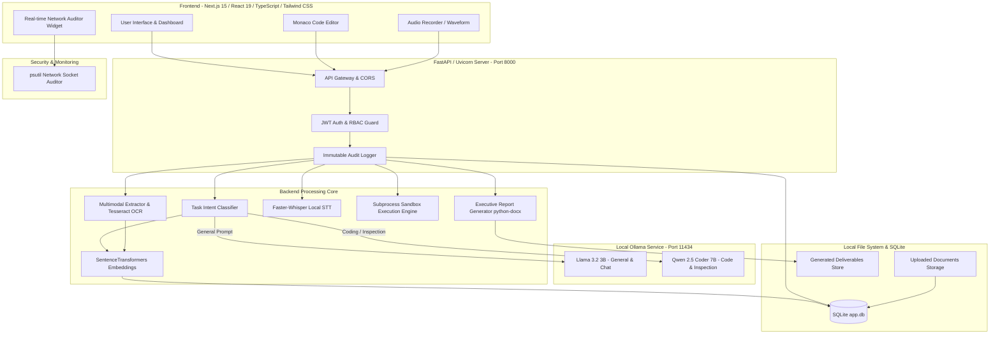
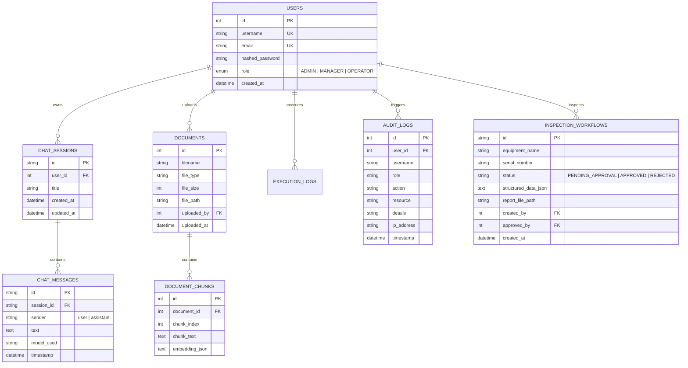
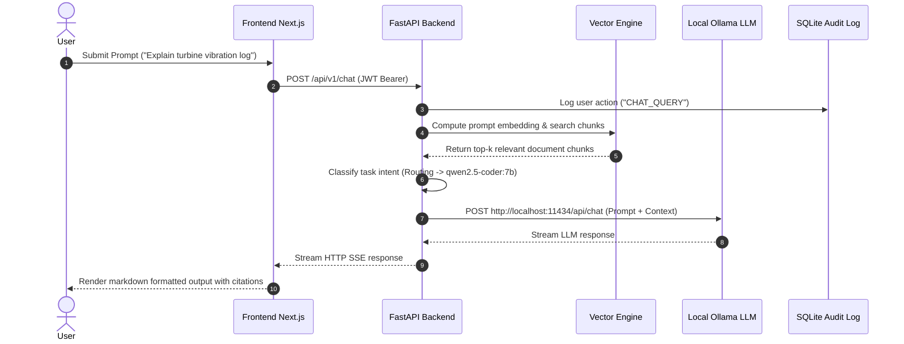
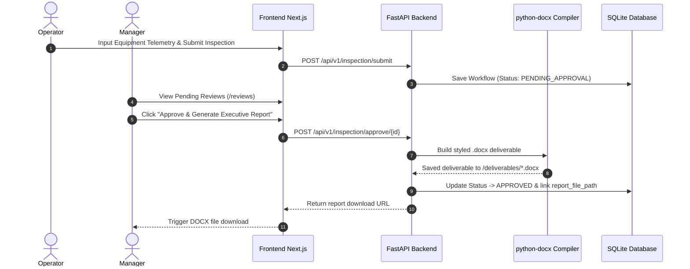

# Sovereign AI — System Architecture & Technical Specifications

> **Air-Gapped Enterprise Intelligent Command Center**  
> *Zero Outbound Connections | Local LLM Orchestration | Subprocess Isolation | Immutable Audit Trail*

---

## 📐 1. Architectural Vision & Core Principles

Sovereign AI is built ground-up to deliver enterprise-grade generative AI, semantic document RAG, automated inspection workflows, and isolated code execution **without sending a single byte of data outside localhost**.

### Core Pillars:
1. **Absolute Air-Gap Security**: Zero external network API dependencies (no OpenAI, Anthropic, or external telemetry).
2. **Dual Local LLM Router**: Context-aware routing between lightweight fast models (`llama3.2:3b`) and high-precision coding/reasoning models (`qwen2.5-coder:7b`).
3. **Multimodal Data Extraction**: Local PDF, DOCX, XLSX, PPTX parsing with PyMuPDF, `python-docx`, `openpyxl`, `python-pptx`, and offline **Tesseract OCR** for scanned images.
4. **Offline Speech-to-Text**: High-speed, local CTranslate2 audio transcription using `faster-whisper`.
5. **Isolated Execution Sandbox**: Windows subprocess isolation with stdout/stderr trapping, execution timeouts, and memory boundaries.
6. **Role-Based Access Control (RBAC)**: Fine-grained `ADMIN`, `MANAGER`, and `OPERATOR` permission matrix backed by JWT tokens and real-time user-attributed audit logging.

---

## 🏗️ 2. High-Level System Blueprint

---

## 🧩 3. Subsystem Architecture Deep Dives

### 3.1. Network Auditor & Air-Gap Compliance Layer (`network_monitor.py`)
- **Mechanism**: Utilizes `psutil.net_connections(kind='inet')` to scan active network sockets bound to the backend PID and child processes.
- **Verification Rule**: Filters out `127.0.0.1`, `localhost`, `0.0.0.0`, and loopback sockets. Any external IP connection triggers a security alert and log entry.
- **Audit Endpoint**: Exposes `/api/v1/system/network-log` returning total outbound attempts (guaranteed `0`) and real-time operational status.

### 3.2. Dual-Model Local LLM Router (`classifier.py`)
- **Intent Classifier**: Inspects incoming prompts for key indicators (code keywords, python snippets, technical inspection terminology, complex tabular data).
- **Routing Rules**:
  - `CODE_ANALYSIS` / `INSPECTION` $\rightarrow$ Routes to `qwen2.5-coder:7b` for precise code generation, syntax accuracy, and structured JSON outputs.
  - `GENERAL_CHAT` / `SUMMARIZATION` $\rightarrow$ Routes to `llama3.2:3b` for low latency and smooth natural conversation.
- **Provider Protocol**: Standard HTTP REST interface communicating directly with Ollama's local port (`11434`).

### 3.3. Multimodal Document Parsing & OCR Pipeline (`extractor.py`)
- **Supported Formats**: `.pdf`, `.docx`, `.xlsx`, `.pptx`, `.png`, `.jpg`, `.jpeg`, `.bmp`, `.tiff`, `.txt`.
- **Extraction Engines**:
  - **PDF**: PyMuPDF (`fitz`) for fast text extraction. If text density is low, automatically falls back to **Tesseract OCR**.
  - **Images**: Local Tesseract OCR engine (`pytesseract`).
  - **Office Documents**: Native parsing via `python-docx`, `openpyxl`, and `python-pptx`.
- **Chunking & Vectorization**: Documents are broken into overlapping semantic text chunks, vectorized using `sentence-transformers/all-MiniLM-L6-v2`, and stored with cosine embeddings in SQLite.

### 3.4. Air-Gapped Speech-to-Text Engine (`whisper_stt.py`)
- **Local Engine**: Uses `faster-whisper` backed by CTranslate2.
- **Execution**: Converts `.wav`, `.mp3`, `.m4a`, `.ogg`, `.webm` client recordings locally without sending audio to external APIs.
- **Resource Management**: Lazy-loads model weights (`base` or `small` quantized model) to maximize GPU/CPU efficiency on standard hardware.

### 3.5. Subprocess Execution Sandbox (`sandbox.py`)
- **Isolation Model**: Executes user Python code in an isolated Windows subprocess using `subprocess.Popen`.
- **Security Boundaries**:
  - **Timeout Enforcement**: Enforces strict execution limits (default 10 seconds).
  - **Memory Limits**: Monitored via `psutil` parent-child process tree inspection.
  - **Output Capture**: Stdout and Stderr piped directly to isolated buffer channels.
  - **Clean Up**: Temporary scripts (`sandbox_temp/`) are destroyed immediately upon execution completion.

### 3.6. Automated Technical Inspection & Executive Report Generator (`report_generator.py`)
- **Multi-Stage Workflow**:
  1. Technical telemetry / sensor data ingested via form or document upload.
  2. Local LLM reasons over parameters against engineering thresholds.
  3. Pending review generated for **Manager / Admin** approval.
  4. Upon approval, compiles an executive `.docx` report featuring custom styled tables, severity callouts, executive summaries, and action item checklists.

---

## 🗄️ 4. Data Model & Database Schema

The database uses SQLite (`app.db`) managed via SQLAlchemy 2.0 ORM:

---

## 🔄 5. Data Flow Sequence Diagrams

### 5.1. Air-Gapped Chat & Semantic RAG Flow

### 5.2. Technical Inspection Approval Workflow

---

## 🛡️ 6. Security Boundaries & Air-Gap Compliance Checklist

| Security Control | Implementation Mechanism | Verification Method |
| :--- | :--- | :--- |
| **Zero Outbound Sockets** | In-process PID net-connection monitoring via `psutil` | `/api/v1/system/network-log` |
| **Data At Rest** | Local SQLite storage with parameterized SQLAlchemy query defense | DB file inspection |
| **Authentication & RBAC** | Passlib Password Hashing (Bcrypt) + PyJWT Token verification | Endpoint Guard Middleware |
| **Code Execution Sandbox** | Isolated subprocess with timeout & memory bounds | Code execution tests |
| **Immutable Audit Trail** | User-attributed audit log entries capturing user ID, role, IP, and timestamp | `/api/v1/audit/logs` |

---

## 🏆 Summary

Sovereign AI's architecture ensures complete data autonomy, zero cloud leakages, and instant local execution for high-security defense, industrial, healthcare, and enterprise environments.

## Database release lifecycle

Database changes are versioned in `backend/migrations` with Alembic. Every release must run
`alembic upgrade head` before the API process starts. Production startup compares the database's
recorded revision with the migration head and fails fast on drift, preventing mixed application and
schema versions. CI verifies upgrade, downgrade, re-upgrade, and model-to-schema drift on SQLite;
production deployments can use PostgreSQL through `DATABASE_URL`.

## Production container topology

The Compose deployment exposes only the Next.js frontend. Next.js proxies same-origin API and health traffic to FastAPI over a private bridge network, and FastAPI connects to PostgreSQL on that same network. Ollama remains host-managed so operators can control GPU drivers and model storage independently. Both application containers run as unprivileged users; the backend performs `alembic upgrade head` before accepting traffic. Liveness gates container orchestration without depending on the model runtime, while `/health` reports database, Ollama, and required-model readiness.
