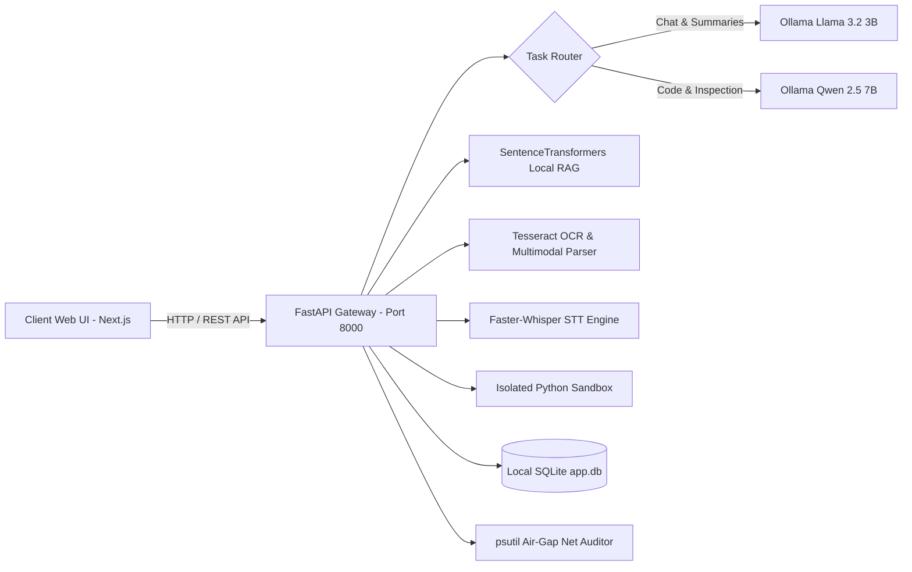

<div align="center">

# 🛡️ Sovereign AI — Air-Gapped Intelligent Command Center

[](LICENSE)
[](#-air-gap-verification-guide)
[](backend)
[](frontend)
[-orange.svg)](ARCHITECTURE.md)

**An enterprise-grade, fully air-gapped AI workspace designed for strict zero-trust security environments, sensitive technical auditing, local LLM execution, and offline document intelligence.**

[Overview](#-what-is-sovereign-ai--sovereign-ai-kya-hai) •
[Features](#-key-features) •
[Tech Stack](#-tech-stack) •
[Architecture](#-system-architecture) •
[How to Use](#-how-to-setup--run-kaise-use-kare) •
[Air-Gap Verification](#-air-gap-verification-guide) •
[License](#-license)

---

</div>

## 📌 What is Sovereign AI? (Sovereign AI kya hai?)

**Sovereign AI** is an all-in-one, completely self-contained AI Command Center built for organizations and sensitive environments (Defense, Industrial, Healthcare, Energy, Financial) where **no data can ever leave the local machine or network**.

Unlike traditional AI solutions that rely on cloud APIs (OpenAI, Anthropic, Google Cloud), Sovereign AI runs **100% locally on your machine**. All LLM inferences, vector embeddings, OCR extraction, audio transcriptions, code sandbox executions, and document report generations occur strictly on `localhost` with **zero external outbound internet calls**.

---

## 🔥 Key Features

### 1. 🔒 100% Air-Gapped Security & Real-Time Socket Audit
- **Zero Outbound Connections**: Real-time socket scanner continuously monitors backend process handles to guarantee zero external telemetry or cloud communication.
- **TopBar Security Badge**: Live network monitor widget in the header provides instant verification of clean zero-outbound status.

### 2. 🧠 Dual-Model Local LLM Router
- **Context-Aware Task Routing**: Automatically routes tasks based on prompt intent:
  - **`llama3.2:3b`**: Used for ultra-fast general chat, document Q&A, and text summarization.
  - **`qwen2.5-coder:7b`**: Used for high-precision technical reasoning, code generation, and structured inspection outputs.

### 3. 📄 Multimodal Document Processing & Local OCR
- Supports `.pdf`, `.docx`, `.xlsx`, `.pptx`, `.png`, `.jpg`, `.jpeg`, `.bmp`, `.tiff`, `.txt`.
- Integrated **Tesseract OCR** engine for offline image and scanned document text extraction.

### 4. 🎙️ Air-Gapped Speech-to-Text (STT)
- Powered by `faster-whisper` (CTranslate2 local engine).
- Transcribes user voice recordings directly inside the browser and backend without sending audio to third-party APIs.

### 5. 🔍 High-Precision Vector RAG & Semantic Knowledge Search
- Employs `sentence-transformers/all-MiniLM-L6-v2` PyTorch models locally.
- Computes high-density cosine similarity embeddings for instant semantic search across all uploaded enterprise files.

### 6. 💻 Isolated Subprocess Code Execution Sandbox
- Run Python scripts safely inside a constrained Windows subprocess sandbox.
- Captures stdout/stderr in real-time with memory limits and execution timeout safeguards.
- Integrated **Monaco Code Editor** with syntax highlighting.

### 7. 📑 Automated Technical Inspection Workflow & Executive Report Generation
- Multi-step technical inspection pipeline designed for engineering telemetry (turbines, pressure valves, transformers).
- **Manager Approval Gate**: Operators submit technical inspection data; Managers/Admins review and approve.
- **Executive `.docx` Compiler**: Automatically generates professionally formatted Word reports (`.docx`) complete with severity callout boxes, data tables, and executive summaries.

### 8. 🔐 Enterprise Role-Based Access Control (RBAC) & Immutable Audit Trail
- Multi-role authorization (`ADMIN`, `MANAGER`, `OPERATOR`).
- Real-time audit log records all user actions with IP attribution, timestamp, role, and action details in SQLite database.

---

## 💻 Tech Stack

| Domain | Technology / Framework | Purpose |
| :--- | :--- | :--- |
| **Frontend UI** | **Next.js 15**, **React 19**, **TypeScript** | Modern, responsive dashboard SPA |
| **Styling & Components** | **Tailwind CSS v4**, **Lucide Icons**, **Mermaid.js** | Premium UI, dynamic charts & workflow diagrams |
| **Code Editor** | **Monaco Editor** | In-browser code editing & execution UI |
| **Backend Framework** | **FastAPI** (Python 3.13), **Uvicorn** | High-performance asynchronous REST API |
| **Database & ORM** | **SQLite**, **SQLAlchemy 2.0** | Persistent local data, RAG chunks & audit storage |
| **Local LLM Engine** | **Ollama** (`llama3.2:3b`, `qwen2.5-coder:7b`) | Offline generative AI & code reasoning |
| **Document Processing** | **PyMuPDF**, **python-docx**, **openpyxl**, **python-pptx** | Document parsing & report compilation |
| **OCR Engine** | **PyTesseract** & **Tesseract OCR** | Offline optical character recognition |
| **Speech-to-Text** | **Faster-Whisper** | Local CTranslate2 audio transcription |
| **Vector RAG Engine** | **SentenceTransformers** & **PyTorch** | Local semantic embedding & vector search |
| **Process Monitoring** | **psutil** | Socket scanning & network air-gap auditing |

---

## 🏗️ System Architecture

Sovereign AI isolates all AI compute and storage locally:



> 📖 For an in-depth architectural breakdown, data models, and sequence diagrams, refer to [**`ARCHITECTURE.md`**](ARCHITECTURE.md).

---

## 🚀 How to Setup & Run (Kaise Use Kare)

Follow these simple steps to launch Sovereign AI locally on your Windows environment.

### Prerequisites

1. **Python 3.10+** (Tested on Python 3.13)
2. **Node.js 18+** & `npm`
3. **Ollama** (Installed locally from [ollama.com](https://ollama.com))
4. **Tesseract OCR** (For scanned image text extraction)

---

### Step 1: Pull Local LLM Models

Open your terminal and pull the required open-weight models via Ollama:

```bash
ollama pull llama3.2:3b
ollama pull qwen2.5-coder:7b
```

Ensure Ollama service is running on `http://localhost:11434`.

---

### Step 2: Setup & Run Backend

1. Navigate to the `backend` directory:
   ```bash
   cd backend
   ```

2. Create & activate a Python virtual environment:
   ```bash
   python -m venv .venv
   .venv\Scripts\activate
   ```

3. Install required backend dependencies:
   ```bash
   pip install -r requirements.txt
   ```

4. Create or upgrade the database schema:
   ```bash
   alembic upgrade head
   ```

5. Start the FastAPI server:
   ```bash
   python -m uvicorn main:app --host 127.0.0.1 --port 8000 --reload
   ```

   The backend will start at `http://127.0.0.1:8000`. Swagger API documentation will be available at `http://127.0.0.1:8000/docs`.

### Production database safety

- Copy `backend/.env.example` into your deployment secret/config system and replace every placeholder.
- Production supports PostgreSQL through `DATABASE_URL`; SQLite remains convenient for single-machine development.
- Run `alembic upgrade head` as a release step before starting the API. With `ENVIRONMENT=production`, the API refuses to start when the database revision is stale.
- Set `TRUSTED_HOSTS` to the exact internal hostnames serving the API. Interactive API docs are disabled by default in production and can be deliberately enabled with `ENABLE_API_DOCS=true`.
- Runtime logs are emitted as JSON with request IDs, latency, route, status, and authenticated actor context. Use `/health/live` for process liveness and `/health` for database/Ollama readiness.
- For a database created by an older Sovereign AI build, take a backup first. If its tables already match the current schema, run `alembic stamp 68928c167acc` once, followed by `alembic upgrade head`.
- Never run `alembic stamp` on a fresh or partially upgraded database; stamping records a revision without changing tables.

### Containerized production deployment

The repository includes non-root, multi-stage containers for the API and web UI plus a health-checked PostgreSQL service. Database migrations run automatically before the API starts, while uploads, generated reports, audio scratch data, and PostgreSQL data use persistent named volumes.

1. Keep Ollama running on the host and pull both models:
   ```bash
   ollama pull llama3.2:3b
   ollama pull qwen2.5-coder:7b
   ```
2. Create deployment secrets without committing them:
   ```bash
   cp .env.compose.example .env
   ```
   Replace `POSTGRES_PASSWORD` and `SECRET_KEY`. Use URL-safe characters for the database password.
3. Build and start the stack:
   ```bash
   docker compose up --build -d
   docker compose ps
   ```
4. Open `http://localhost:3000`. Check API process liveness through `http://localhost:3000/health/live` and full database/model readiness through `http://localhost:3000/health`.

For HTTPS deployments, set `PUBLIC_ORIGIN` to the exact HTTPS URL and `AUTH_COOKIE_SECURE=true`. Only the frontend publishes a host port; PostgreSQL and the backend remain on the private Compose network. Code execution stays disabled in this deployment because it requires a dedicated isolated worker.

Stop containers with `docker compose down`. Persistent data remains intact. Use `docker compose down -v` only when you intentionally want to permanently delete all Compose-managed data.

---

### Step 3: Setup & Run Frontend

1. Open a new terminal and navigate to the `frontend` directory:
   ```bash
   cd frontend
   ```

2. Install Node dependencies:
   ```bash
   npm install
   ```

3. Start the Next.js development server:
   ```bash
   npm run dev
   ```

4. Open your browser and navigate to:
   ```text
   http://localhost:3000
   ```

---

## 🔒 Air-Gap Verification Guide

To verify that Sovereign AI operates with **ZERO external network activity**:

### Method 1: Live API Socket Verification
Query the live network auditing endpoint while performing actions:
```bash
curl http://127.0.0.1:8000/api/v1/system/network-log
```
**Expected Output:**
```json
{
  "total_outbound_attempts": 0,
  "events": [],
  "current_status": "CLEAN - No external connections detected"
}
```

### Method 2: Physical Internet Disconnect Test (Ultimate Proof)
1. Turn off Wi-Fi or unplug your Ethernet network cable.
2. Execute all features:
   - Chat with LLM (`/chat`)
   - Upload & parse documents (`/documents`)
   - Run semantic knowledge queries (`/knowledge`)
   - Run code scripts in the sandbox (`/sandbox`)
   - Generate technical inspection `.docx` reports (`/inspection`)
3. **Result**: All features perform seamlessly at 100% speed with zero timeouts or errors.

---

## 📁 Repository Structure

```text
sovereign-ai/
├── ARCHITECTURE.md                  # Comprehensive architectural specifications & diagrams
├── README.md                        # Master documentation & setup guide
├── LICENSE                          # MIT License file
├── .gitignore                       # Clean root ignore rule definitions
├── assets/                          # Screenshots, logos, and presentation assets
│   ├── sovereign_logo.png
│   ├── screenshot_demo.png
│   ├── system_preview.jpeg
│   └── SIH2026-IDEA-Presentation-Format.pptx
├── backend/                         # FastAPI Application Core
│   ├── main.py                      # REST API routes & app lifecycle
│   ├── models.py                    # SQLAlchemy Database Models
│   ├── schemas.py                   # Pydantic request/response schemas
│   ├── classifier.py                # Dual-LLM intent router logic
│   ├── extractor.py                 # File & image OCR text extraction engine
│   ├── embeddings.py                # Local SentenceTransformers RAG vectorizer
│   ├── sandbox.py                   # Subprocess code sandbox isolation
│   ├── report_generator.py          # Executive python-docx report generator
│   ├── network_monitor.py           # Real-time socket scanner & air-gap monitor
│   ├── whisper_stt.py               # Local Faster-Whisper audio STT engine
│   ├── auth.py                      # JWT Authentication & RBAC rules
│   ├── requirements.txt             # Python backend dependencies
│   └── database.py                  # Database connection manager
└── frontend/                        # Next.js 15 Frontend Web UI
    ├── src/
    │   ├── app/                     # Next.js App Router pages (chat, documents, audit, etc.)
    │   ├── components/              # AppShell, TopBar, Sidebar, MarkdownRenderer
    ├── package.json                 # Frontend dependencies & scripts
    └── tsconfig.json                # TypeScript configuration
```

---

## 📄 License

This project is licensed under the **MIT License** — see the [LICENSE](LICENSE) file for details.

```text
MIT License - Copyright (c) 2026 Sovereign AI Contributors
```

---

<div align="center">

**Designed & Built for Absolute Data Autonomy**  
*Sovereign AI — Air-Gapped Intelligent Command Center*

</div>
